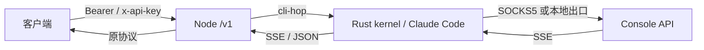
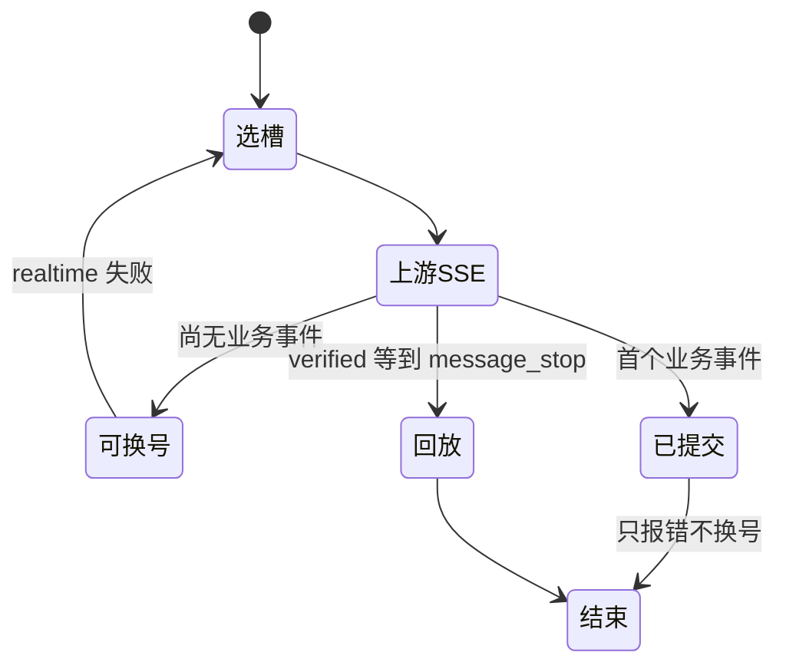

# API 用法

协议口默认本机 `:8787`（生产可用 nginx 反代）。本文只写 **现在代码里的客户端契约**。面板口见 [PANEL_API.md](PANEL_API.md)。出站行为见 [PROTOCOL.md](PROTOCOL.md)。



## 鉴权

| 密钥 | 来源 | 能调 |
|------|------|------|
| Master `VM2API_API_KEY` | 环境变量 | `/v1/*` + `/api/panel/*` + `/admin/*` |
| `sk-vm-…` | 控制台签发 | **只** `/v1/*` |
| 面板会话 | 面板登录 | **只** `/api/panel/*` |

请求头任选其一：

```http
Authorization: Bearer sk-vm-…
x-api-key: sk-vm-…
```

没有密钥 → `401 missing_api_key`。协议密钥调面板 → `403 forbidden`。

## 端点

| 方法 | 路径 | 入站 | 出站给客户端 |
|------|------|------|--------------|
| `POST` | `/v1/messages` 或 `/messages` | Anthropic Messages | Anthropic Messages / SSE |
| `GET` | `/v1/usage` | — | 当前账户 5H/7D，Claude 与 GPT 均可（`unit=percent_used`） |
| `POST` | `/v1/chat/completions` 或 `/chat/completions` | OpenAI Chat | OpenAI Chat / SSE |
| `POST` | `/v1/completions` 或 `/completions` | OpenAI Completions | OpenAI Completions |
| `POST` | `/v1/responses` 或 `/responses` | OpenAI Responses | OpenAI Responses |
| `GET` + Upgrade | `/v1/responses` 或 `/responses` | Responses WebSocket | JSON `response.*` 帧，不包 SSE |
| `GET` | `/v1/models` | — | 本地模型策略目录 |
| `GET` | `/health` · `/` · `/v1/meta` | 无鉴权 | 能力 / 限制 / 计数 |

上游 hop **永远** `stream: true`。客户端 `stream: true` 收 SSE；`stream: false` 或 `x-kin-delivery: verified` 由网关聚合成 JSON。

别名路径（无 `/v1` 前缀）与上表相同处理函数。

## Responses WebSocket

用相同 Bearer API key 对 `GET /v1/responses` 发起标准 WebSocket Upgrade，然后发送文本帧：

```json
{"type":"response.create","model":"gpt-5.4","input":[{"role":"user","content":"hi"}]}
```

`stream` 可省略，显式指定时必须为 `true`。每轮走既有鉴权、密钥范围、限流、调度、用量与日志链路；响应为独立 JSON `response.*` 事件，不带 `event:` / `data:` 或 `[DONE]`。同连接串行执行，接收队列最多 32 条，累计排队字节还受现有请求体上限约束；超过帧/字节上限关闭 1009，队列条数超限关闭 1008，二进制帧关闭 1003。客户端断开会取消当前 hop。普通 GET 未带 Upgrade 返回 426。

同连接已完成响应的 `previous_response_id` 会展开为原输入与完整输出（含 reasoning / tool items）再执行，不依赖上游保留旧 WS。回放缓存最多 32 条 / 8 MiB。未知、已淘汰或另一连接的 ID 返回 `400 previous_response_not_found`，要求携带完整上下文重发；不会假装原生跨连接续接。当前只接受 `response.create`，未实现的控制事件返回明确协议错误，不伪装已转发或成功。

`websocket.enabled` 和 `codex.websocket.enabled` 必须同时为 true；任一关闭，新握手返回 `403 websocket_disabled`，已有连接的后续 create 也会复核。HTTP/SSE 不关闭，上游强制 HTTP。仅把 `codex.upstream_transport` 设为 `http` 时，入站 WS 仍可用，但每轮走 HTTP/SSE 上游；依赖 WS 的 `generate:false` 预热返回 `400 unsupported_prewarm`，零上游执行。配置入口见 [OpenAI 传输与隐私](PANEL_API.md#openai-传输与隐私)。

握手后的失败形态为 `{"type":"error","status":400,"error":{"type":"invalid_request_error","code":"…","message":"…"}}`，保留已确认的真实错误；没有终态时报告 `incomplete_response`，不合成 `response.completed`。

## 公共请求头

| 头 | 作用 |
|----|------|
| `content-type: application/json` | 必填 |
| `x-session-id` / `x-conversation-id` / `x-claude-code-session-id` | sticky 键（见 `routing.sticky`） |
| 交付模式 `verified` | 缓冲到 `message_stop` 再回放 |
| 缓存 TTL `1h` | Node 新增点的缺省值；`x-kin-cache-ttl: 5m` 参与首次会话选择，不覆盖 native 透传 caller / 模板显式 TTL |
| 调试开关 | 单请求日志模式 |
| 钉槽（仅 master） | 虚拟机测试 loopback |
| `X-Request-ID` | 原样回写响应头 |

体大小上限由设置里的「请求体上限」决定（`failover.max_request_mib`，未设置时槽内 kernel 为 32 MiB）。网关进程天花板是 `KIN_MAX_BODY`（默认 128MB），面板值不能超过它。超限在选号之前返回 `413 body_too_large`；已经进槽、仍大于 kernel 缓冲的请求由 kernel 返回 413。改完保存后，各槽 kernel 在没有请求时重启一次才生效。

## Messages

```bash
curl -sS http://127.0.0.1:8787/v1/messages \
  -H "Authorization: Bearer $KEY" \
  -H "content-type: application/json" \
  -H "x-session-id: conv-1" \
  -d '{
    "model": "claude-sonnet-5",
    "max_tokens": 128000,
    "messages": [{"role": "user", "content": "hello"}]
  }'
```

必填：`model`、非空 `messages[]`（每条有 `role`，以及 `content` 或 `tool_calls`）。`max_tokens` 可省，缺省填 **128000**。

流式：`"stream": true`，响应 `text/event-stream`，事件与 Anthropic 相同（`message_start` … `message_stop`）。

非官方入站会被改写成配置选定的 persona system 再发给上游；**回包不带改写后的 system**。`persona_preset=official` 保留 billing、identity、调用方 agent prompt（若有）和调用方 system；`persona_preset=official_full` 才固定追加完整 Claude Code agent prompt。非官方 `usage` 按「没有 persona system、没有注入 tools」估算。官方 Claude Code 四闸全过则体不改、usage 不藏。

支持的 Messages 字段原样进入清洗层：`system`、`tools`、`tool_choice`、`thinking`、`output_config`、`metadata`、`stop_sequences`、图片块、`cache_control`。非法 `role` 会洗掉。OpenAI 形态 tools 出现在本口时先转成 Anthropic tools，但仍判非官方。

native cli-hop 开启官方家族透传时，调用方 `cache_control` 的位置、显式 TTL 与缺失 TTL 保留。超过四个 breakpoint、thinking 上打点、非法 TTL，或 `5m`（含缺失 TTL）之后出现 `1h`，返回 `400 invalid_cache_control`，不静默裁剪或降级、不执行上游。非透传仍按协议重写规则生成自产点；kernel 不再替前置层修复 TTL 顺序。

### Sonnet 5.5 兼容边界

`claude-sonnet-5-5` 不支持原生强制工具调用。Node 沿用 Opus 5.5 策略：`tool_choice=any/tool/required` 转成 `{type:auto}`；指定名称的客户端工具设置 `strict:true`，服务端工具不加该字段。不注入提示词，也不把普通文本伪造成工具调用。**strict 只约束实际工具调用的参数，不保证一定调用或只调用指定工具。** 需要原生强制调用时继续使用支持该能力的模型，例如 `claude-sonnet-5`；其行为不变。

规则覆盖 Messages、Chat Completions、Responses 的出站清洗。`auto` / `none` 保持；不支持的 disabled/enabled thinking 转为 adaptive，保留 display。结构化输出转换保留 `output_config.effort`，已有 `output_config.format` 优先，否则从 `response_format` / `text.format` 合并，cli-hop 与普通出站路径均补齐对象 schema 的 `additionalProperties:false`（不覆盖显式值）。


## Chat Completions

```bash
curl -sS http://127.0.0.1:8787/v1/chat/completions \
  -H "Authorization: Bearer $KEY" \
  -H "content-type: application/json" \
  -d '{
    "model": "claude-sonnet-5",
    "messages": [
      {"role": "system", "content": "你是一个高速收费员。"},
      {"role": "user", "content": "你好呀。"}
    ]
  }'
```

转换（`convert.mjs`）：

| OpenAI | 上游 Messages |
|--------|----------------|
| `messages[].role=system\|developer` | 顶层 `system`；完整 official 模板先放 billing + identity + agent_prompt，再把调用方 system 作为末块 append |
| `tools[].function` | Anthropic `tools[]` |
| `tool_choice=required` | `{type:any}` |
| `tool_choice.function` | `{type:tool,name}` |
| `reasoning_effort` / `reasoning.effort` | `thinking.enabled + budget` |
| `response_format` | `output_config` |
| 图片 `image_url` | Anthropic image 块 |

回包：

```json
{
  "id": "chatcmpl-…",
  "object": "chat.completion",
  "choices": [{
    "index": 0,
    "message": {"role": "assistant", "content": "…", "tool_calls": []},
    "finish_reason": "stop"
  }],
  "usage": {
    "prompt_tokens": 0,
    "completion_tokens": 24,
    "total_tokens": 24,
    "prompt_tokens_details": {"cached_tokens": 0}
  }
}
```

`finish_reason`：`tool_use` → `tool_calls`，`max_tokens` → `length`，`refusal` → `content_filter`。空 refusal 会填 `message.refusal`，避免空白 completion。

流式：`data: {choices:[{delta:{content}}]}`，结束 `data: [DONE]`。

## Completions / Responses

`POST /v1/completions`：`prompt`（字符串或非空数组）必填，转成单条 user Messages。

`POST /v1/responses`：`input` 或 `messages` 必填。回包 `usage.input_tokens_details` 带缓存明细。`stop_reason=refusal` 同样映射 content_filter。

## 模型目录

```bash
curl -sS http://127.0.0.1:8787/v1/models -H "Authorization: Bearer $KEY"
```

读面板持久化的 `model_policy`，**不** hop 槽位 `/v1/models`。列表按密钥 `group_type` 过滤：`openai` 只列 GPT，`anthropic` 只列 Claude，`all` 与 master 两者都列。`POST /admin/models/refresh` 仍回完整目录。未入库的 id → `400`，请求被拒，不上游。别名如 `claude-haiku-4-5` 可解析到带日期的目录项。出站 `model` 去掉 `[1m]` 后缀。

## usage
```bash
curl -sS http://127.0.0.1:8787/v1/usage -H "Authorization: Bearer $KEY"
```

`GET /v1/usage` 返回调度器下一次会选到的账户的用量，只在调用方自己的属主范围和密钥范围内选：先选 Claude 账户；没有可用的 Claude 账户时，再选 GPT（Codex）槽位。可用 `?platform=claude` 或 `?platform=openai` 只看一类，其他值返回 `400 invalid_platform`。成功：

```json
{
  "unit": "percent_used",
  "five_hour": { "utilization": 12, "status": "active", "resets_at": "…" },
  "seven_day": { "utilization": 34, "status": "ok", "resets_at": "…" },
  "source": "extra",
  "platform": "anthropic"
}
```

`platform` 为 `anthropic` 或 `openai`。GPT 槽位读本地记录的 Codex 5h/7d 窗口（`source=codex`），不发起上游请求。

`utilization` 0–100。Claude 槽位：有 Messages Extra 用 Extra；两窗都空才走一次带缓存的官方 `/api/oauth/usage`（`source=oauth-usage`）。Setup Token 只有 `user:inference` 时官方 usage 会返回 scope 错误；服务端保留失败原因，不把它当吊销/封禁，也不改历史套餐。Console API Key 调 `/v1/usage` → `400 usage_unsupported`。窗缺失为 `null`，不伪装 0%。

## 面板额度探测

`POST /api/panel/probe` 是手动 fresh 探测，默认等同：

```json
{ "hop": true, "force": true }
```

可传 `{ "hop": false }` 只读最近 Messages 响应头缓存；`force:false` 则允许复用 usage cache。返回 `items[]`，每项 `ok:false` 会带 `error`，顶栏按成功/失败分别提示。

套餐判定只认成功且完整的官方 usage：必须有 5h、7d，并能确定 Fable 7d 是否存在；有 Fable 7d 即 Max，没有即 Pro。失败、scope 不足、只有 5h、CLI 文本不完整都不改套餐。未知但有票的账号在面板显示为“待探测/未确认”，不是第三套餐。


### 周期额度查询的重置后错峰

`PUT /api/panel/routing` 可设置（沿用面板鉴权；不是手动 `/probe` 请求体）：

```json
{
  "usage_probe": {
    "enabled": true,
    "reset_delay_sec": 120,
    "reset_jitter_sec": 600
  }
}
```

两项均默认 `0`、范围 `0`–`3600` 秒，省略时保留旧行为。对已到期且带有效重置时间的 Extra `5h` 窗口，周期查询的最早时间为 `reset + reset_delay_sec + 每账号稳定偏移`；偏移在 `0`–`reset_jitter_sec` 内，由账号身份和该轮 reset 确定，重复 tick、进程重启及列表重排不会重新抽签。上例为重置后 120–720 秒；实际执行仍受 `interval_sec` 的 tick 粒度、并发、单飞及退避限制，不保证每个账号不同秒执行。等待项在 `GET /api/panel/usage-probe` 的快照中显示 `reason: "reset_probe_delay"` 和 `next_probe_at`（最早时间，不是预约保证）。

这只调整**周期额度探测链路的执行时间**，不新增探测：现有链路以官方 `GET /api/oauth/usage` 查询为主，满足套餐复核条件时仍可能执行现有 Fable Messages 探测；本改动不改变这些条件。没有有效已到期 5h reset 的未采样账号、仅 7d 到期或无有效 5h reset 的账号保留原逻辑；已有 `last_probe.ok === true` 且探测时间不早于本轮 reset 的账号不再被旧 reset 延迟，仅由真实流量更新的 `headers.sampled_at` 不触发该豁免。官方 usage 退避优先，主动/过期样本和套餐复核路径不会绕过等待。主动调用 `POST /api/panel/usage-probe` 同样运行周期规则；手动 `POST /api/panel/probe`、事件 `probeNow`、真实用户流量及独立 Messages 健康检查不受此延迟影响。

因此，这些设置**不保证上游 5h 计费/额度窗口错开**：官方 usage GET 是否会开启窗口没有得到验证，既有 Fable Messages、真实流量及独立 Messages 健康检查也可能触发新窗口。延迟会让面板/额度恢复信息更晚刷新；需要即时查询时使用手动 `/probe`。当前仅提供 routing/API 配置，不新增面板控件。

## 健康

```bash
curl -sS http://127.0.0.1:8787/health
```

无鉴权。含 `features`、`limitations`、`stats`。能力字面量：`passthrough`、`stream`、`verified-stream`、`protocol-convert`、`go-slot-worker`、`account-pool-failover`、`tools`、`client-workspace`、`account_usage`。

## 错误

协议口错误体：

```json
{
  "error": {
    "type": "invalid_request_error",
    "code": "missing_field",
    "message": "…",
    "param": "model",
    "request_id": "…"
  }
}
```

| type | 典型 HTTP |
|------|-----------|
| `authentication_error` | 401 |
| `permission_error` | 403 |
| `policy_blocked`（拒答守卫） | 400 |
| `invalid_request_error` | 400 |
| `rate_limit_error` | 429 |
| `quota_error` | 429 |
| `overloaded_error` | 503 / 529 |
| `timeout_error` | 504；客户端断开 499 |
| `upstream_error` | 401/403/502 |
| `api_error` | 500 |

上游 429 失败转移用尽后原样返回 429 `upstream_rate_limit`，有上游 `retry-after` 时透传；529 一定带 `retry-after`（号池估计，上游 529 取上游值，都没有时为 1）。恢复备份期间协议口 `503 restore_in_progress`。健康探测短请求在无缓存且 fail-closed 时 `503`。Claude Code Usage Policy `API Error`（含内核报成 400 的）不换号、不修复重试，客户端收到 400 `policy_blocked` / `refusal_guard`，避免 Claude Code 误提示 `/login` 或按一般 400 做修复重试；并把该 prompt 永久写入拒答缓存；再次相同请求，或用户正文与已缓存正文的估计 Jaccard 达到面板阈值（默认 0.90，可选 0.80/0.85/0.90/0.95），都在 hop 前被拦。`content_policy`、`cyber_policy`、`moderation_blocked` 等内容错误码同样入库。协议硬正则，或面板所选的 Jev / Laya / ModernBERT（`/v1/systemone`，`noul ≥ 0.5`）判为 NSFW、蒸馏、破解、破限时返回 403 `policy_blocked`，不 hop，不写入拒答缓存；device 封禁开启时封禁入站 device。模型不可用且 `fail_open` 为 false 时同样 403，文案写明决策模型不可用，不封设备。近似和 device 封禁可在面板关闭。拒答命中在 device 封禁开启时还会永久封禁该入站 device id。400 的原文后追加原因，`details.reason` 为 `device` / `exact` / `similar`。

号池结果分开返回，不互相伪装：

| 情况 | HTTP | code | message |
|---|---|---|---|
| 排队超时、排队已满（`routing.pool.queue_max`）、有界等待用完、最后一跳内核槽忙（`slot_busy`），或剩余账号都在上游 529 过载冷却（`overload_until`） | 529（`overloaded_error`） | `pool_overloaded` | 号池负载过高，稍后再试 |
| 剩余账号都在上游 429 限流冷却（`rate_limit_reset_at`），没有过载冷却 | 429（`rate_limit_error`） | `upstream_rate_limit` | 号池账号均被上游限流，稍后再试 |
| 没有任何合格账号（未配置、额度 / 凭证 / 模型 / 人工关闭都不合格，且没有上游冷却） | 503 | `pool_unavailable` | 号池当前没有可用账号 |
| 已经执行过、最后一跳失败 | 上游本义 | 上游错误码（如 `incomplete_response`、429、401） | 上游本义 |

`pool_overloaded` 是 HTTP 529、`type: overloaded_error`，总带 `retry-after`（秒，至少 1）：优先取相关 VM 最早的席位宽限到期，其次已知恢复时刻（冷却、RPM 窗口），都没有时为 1。排队已满时立即返回，不入队。OpenAI 槽仍是自己的 429 `pool_overloaded`。续接 `previous_response_id` 的 Responses 请求只能在原 GPT 账号上继续；该账号已不可用时返回 `409 response_not_portable`，请带完整上下文重新发起。

客户端断开不计 SLA、不处罚账号。

### CLI / kernel 故障与取消

已知原因不会再被统一改成 `incomplete_response`。流式与非流式都保留错误码、真实 HTTP 状态和 `retry-after`；已写出业务 SSE 时只结束当前流，不重放。

| code | HTTP | 含义 |
|---|---|---|
| `upstream_network_error` | 502 | 建连 / 代理 / 网络失败，尚未收到上游事件 |
| `upstream_stream_interrupted` | 502 | 上游事件流中断 |
| `upstream_empty_stream` | 502 | 上游没有发出任何事件就结束 |
| `cli_error` / `kernel_error` | 502 | 本地 CLI / 内核失败，不写账号冷却 |
| `kernel_unavailable` | 503 | CLI 正在恢复或恢复预算耗尽；换到可用 VM |
| `upstream_timeout` | 504 | 上游或 job 静默超时 |

上游 400/404、401/403、429、5xx 分别保留 `upstream_invalid_request`、`upstream_auth_error`、`upstream_rate_limit`、`upstream_error`（过载为 `upstream_overloaded` / 529）。一次 native job 只发一次上游请求；CLI 不做隐藏重试、换模型或流式转非流式，重放预算由 Node 统一计数。

客户端取消经内部鉴权的 `POST /internal/v1/cancel {"request_id":"单次 hop ID"}` 传到 CLI。每次执行使用不同 ID；提前到达的取消也阻止后续提交。HTTP 断开是第二条兜底路径。取消不会触发重试、账号处罚或重启；CLI 任务真正结束并返回匹配 `cancel_ack` 前，内核不复用该 slot。取消一个任务不阻塞其他 slot 或探活。

自动恢复由低到高，不能由普通推理请求绕过：

1. Cancel ack 超过 30 秒：只关闭该 slot，最多重发 3 次取消，间隔 30 / 60 / 120 秒；匹配的迟到 ack 恢复该 slot。
2. 共享 CLI 60 秒无输出且有在途任务、job 超时或出现关闭 slot：用 `ping` / `pong` 探测，最多 3 次，间隔 10 秒。正常长请求可回答 pong，不按请求总时长判死。
3. 探活失败、进程退出、stdin 断管 / 写入超过 10 秒、全部 slot 关闭或至少半数关闭且无在途任务：内核只重启 CLI 子进程，10 分钟内最多 3 次，等待 10 / 30 / 60 秒。
4. 内核不可达或 CLI 恢复已耗尽：Node watchdog 才重启容器，1 小时内最多 3 次，每次先等待 1 / 5 / 15 分钟。
5. 容器恢复仍失败：停止自动重启，排除该 VM（粘性与诊断 pin 都不能绕过），经配置的通知渠道告警。观察到内核恢复健康后解除故障；运行中的 cc-node/crag 保留原有不重启例外。

内部 `/internal/health` 暴露 `healthy`、`unhealthy_reason`、`recovering`、`closed_slots`、`cli_restarts`、`ready_slots`、`cli_pid`。`ready_slots=0` 且 CLI 存活是忙，`recovering=true` 是内核自身恢复；二者都不是容器重启理由。旧字段 `wedged_slots` 已移除。


### `502 incomplete_response`

```json
{"error":{"type":"upstream_error","code":"incomplete_response","message":"Assistant hop ended without visible output or stop_reason"}}
```

含义：请求已交给槽内 CLI，既没有明确的错误原因，也没有可见输出（text / tool_use / refusal）或 `stop_reason`。只有 thinking 也算。上一次执行已经结束且尚未向客户端写出时，网关先换到别的空闲 VM 重放，没有空位才回到同一 VM；同一请求在同一 VM 上最多实际执行 3 次（含传输层隐藏重试）。都用完仍不完整，才把这个 502 交回客户端。这一次请求不停调、不写账号冷却，也不因计数重启 CLI。一开始就没有可用账号时，返回 `pool_unavailable`。客户端主动断开是 `client_cancelled`，不是这个错误。诊断钉死在某一个槽时，停在该槽并返回这个错误。

常见原因与处理：

| 现象 | 原因 | 处理 |
|---|---|---|
| 同一个槽的请求**全部**失败，网络 / 超时错误；面板代理探测却是绿的 | 槽容器到宿主机 `kin-egress` 网关被宿主机防火墙拦截（常见于 UFW 入站默认拒绝）。容器内 DNS 和出站 TCP 超时 | 放行 `keg*` 网卡到网关端口的入站，见 [DEPLOY.md「防火墙」](DEPLOY.md#防火墙ufw--firewalld) |
| 偶发，重试后成功 | 上游流中断（新二进制报 `upstream_stream_interrupted`）或模型只返回了 thinking | 尚未提交的请求可重放；同一 VM 最多 3 次 |
| 某个槽持续失败 | slot 取消未结束或共享 CLI 不再响应 | 内核先隔离 slot / 重启 CLI；预算耗尽后 watchdog 才重启容器并最终告警，不需要每次手工重启 |

面板代理探测是从宿主机本机连网关端口，不经过「容器 → 网关」这一跳，所以防火墙拦截时它仍显示正常。确认方法：

```bash
# 在宿主机上，进入出问题的槽容器测 DNS 和出站
docker exec kin-<槽> getent hosts api.anthropic.com
docker exec kin-<槽> curl -sS -o /dev/null -w '%{http_code}\n' --max-time 10 https://api.anthropic.com
```

两条都超时即为防火墙拦截；能解析且返回 HTTP 状态码（如 404）说明出口正常，再查上游和凭证。

## 交付与粘性



- **realtime（默认）**：第一段业务 SSE 写出后不再换账号。
- **verified**：收齐 `message_stop` 再给客户端；不完整则继续换号。
- 席位（预调度）：出站占位的首要身份是 device id / machine id，其次才是 session id。一个 machine（`metadata.user_id.device_id`、`device_id`、`x-kin-device-id`）先占一台 VM。同一 machine 再来的 session 优先使用这台 VM 里还空着的槽；槽满了才等这台 VM，等不到才去别的 VM。每个 session 在请求进行中独占一个槽；这一轮结束且该 session 没有排在这台 VM 上的后续请求时，槽立刻释放。粘性 TTL 只记住用过的 VM，不占 `session_slots`。没有 device / machine 时，按 session id 占槽；再没有才用 `cache_control: ephemeral` 内容哈希，然后是客户端 IP + 归一化 UA + system + 首轮 user 内容哈希。API key 从不参与。同一 session 的并发请求共用这一个席位。每台 VM 的席位数是 `session_slots`（VM 覆盖 → `inference.session_slots`，上限 20）。额度 / 凭证 / 暂停等确定失效，或换 VM 重试，才立刻释放，到新 VM 再占一个槽。开新席位要求余量 `min(limit_5h − u5, limit_7d − u7) ≥ (已占 + 1) × seat_budget_reserve_pct`。都满时进全局 FIFO。有粘性 VM 的先在该 VM 等 `sticky_wait_timeout_ms`，再转全局等 `fallback_wait_timeout_ms`。超时返回 529。一次性短探测和诊断 pin 不占席位。分配原因：`device-affinity` 是这台 machine 已有的 VM，`sticky` 是这个 session 自己的绑定，`family-affinity` 是父会话所在 VM。
- sticky：同一会话在终态成功后记住 VM；粘性 TTL 内这台 VM 是该 session 新开席位的首选。对话结束后不占席位。不可调度 / 错误会清掉这份记忆。
- 5h/7d 闸（`routing.quota`）：用量进入闸线下 `critical_band`（默认 5 个百分点）起为「临近闸线」，一直到闸线上 `gate_overshoot`（默认 5 个百分点）。这一段里已入座的 device 留在原 VM：同账号一次只跑一个请求（额度读数滞后于在飞请求），第二个并发在原 VM 排队，不换 VM；新 device 优先开到其他正常 VM，用量已过闸线时不再开新席位。用量达到闸线 + `gate_overshoot` 才让出席位换 VM；上游 rejected / 100% / 429 冷却始终立即换。
- 重试预算：每个 VM 每请求最多 3 次实际执行；准入竞争失败不算一次执行。`failover.max_total_attempts` / `max_account_switches` 用完后只再尝试本请求还没试过的 VM，直到 `total_retry_deadline_ms`。
- 流空闲上限：上游流连续无事件超过 `failover.stream_idle_timeout_ms`（默认 180 秒，面板「重试与切号」可调，30 秒–60 分钟）即判超时。网关、槽内 kernel 的流空闲上限和 job 看门狗（kernel 读的是不带前缀的环境变量 `JOB_IDLE_SECS`，由 kernel 启动脚本从 `kernel.json` 读取并导出；`KIN_JOB_IDLE_SECS` 不生效）共用这个值。保存后立即热写入各槽 `kernel.json`；job 看门狗只在 kernel 启动时读取，所以值变化后各运行中的 Claude 槽会在没有任务时自动重启 kernel（有任务则等它结束，另每 15 秒复查一次）。不带 `eager_input_streaming` 时，上游会把大工具入参（如长 `Write` 内容）整段缓冲，期间可能静默数分钟。未配置时用环境变量 `KIN_STREAM_IDLE_TIMEOUT`。
- 排队保活（仅 Claude `stream: true`）：选席、同会话串行、失败重试都发生在上游尝试开始之前，这段时间原先不下发任何字节。Cloudflare 约 100 秒收不到响应会回 524。`failover.queue_keepalive_delay_ms`（默认 60 秒，上限 90 秒，也可用 `KIN_QUEUE_KEEPALIVE_DELAY`）过后开始写 SSE `event: ping`，间隔与 `stream_keepalive_ms` 相同，并一直持续到首个内容事件。延迟之内失败仍是 HTTP 429/529/503。一旦写出 ping，状态码不能再改，后续失败改为 SSE `event: error`（例如 `overloaded_error`）。同会话排队另有 `failover.session_queue_timeout_ms`（默认 15 分钟；`0` 表示不限制），超时按 529 `overloaded_error` 返回，不会和仍在跑的上一轮并发。Codex / OpenAI 路径不变。
- 工具参数流式下发：`failover.eager_tool_streaming`（默认开，面板「重试与切号」开关；显式 `false` 关闭）。开启后给所有自定义工具加 `eager_input_streaming: true`（服务端工具不动），上游边生成边下发大参数，不再长时间静默。这与官方 Claude Code 开启细粒度工具流式时的形态一致：官方只在直连官方 base URL 且服务端开关 `tengu_fgts` 打开，或设置 `CLAUDE_CODE_ENABLE_FINE_GRAINED_TOOL_STREAMING=1` 时给全部工具加这个字段，所以经中转的客户端默认不带。客户端自己带了这个布尔值时以客户端为准。参数在 `max_tokens` 截断时可能是不完整的 JSON。OpenAI chat/responses 入口的 function 工具在转成 Anthropic 后同样加这个字段。
- 子请求：带显式 `parent_session_id` / `root_session_id` 且父会话在本地已有绑定时，子请求跟随父会话所在 VM（family 粘性）。子会话有自己的 session id，单独占一个席位，不和父会话或同 device 的其它会话共用。没有显式父子字段时，同设备的新会话不会被当作子请求。
- Claude Code 子 agent：请求头带 `x-claude-code-agent-id` 时，按上一条的子请求处理，父会话是 `metadata.user_id.session_id`，子会话 ID 由它和 agent ID 派生。每个 agent 单独串行，不等父会话当前这一轮。
- 裸 429（没有 5h/7d 头、没有套餐文案）不按模型名定范围：当前执行单元短暂让位并触发一次 `/usage` 探测，由真实用量决定是否是账号额度。上游文本点名模型的才按模型冷却，每分钟限流按 RPM 短冷却。

## 用量回包

非官方：客户端看到的 `input_tokens` / `cache_*` 扣掉网关注入的 persona system 块和 server tools。调用方自己的 prompt / tools 仍计入。官方 Claude Code 不扣。

`request_logs` 与计费始终用上游真数（含 cache 5m/1h）。

## 最小联调清单

1. `GET /health` 200  
2. `GET /v1/models` 带密钥，看到策略目录  
3. `POST /v1/messages` 非流 `hello`  
4. 同请求加 `"stream": true`，能收到 `message_stop`  
5. `POST /v1/chat/completions` 一条 system + user  
6. 带 `x-session-id` 连打两轮，日志 attempt 落同一槽（该槽仍可用时）
