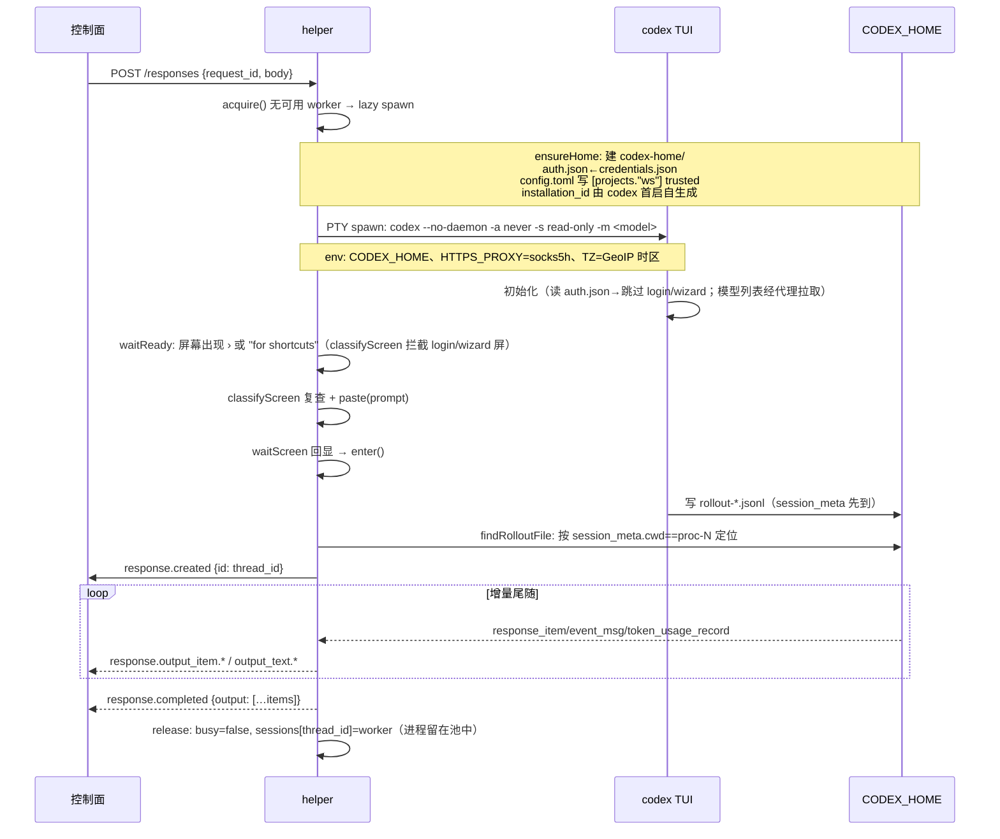
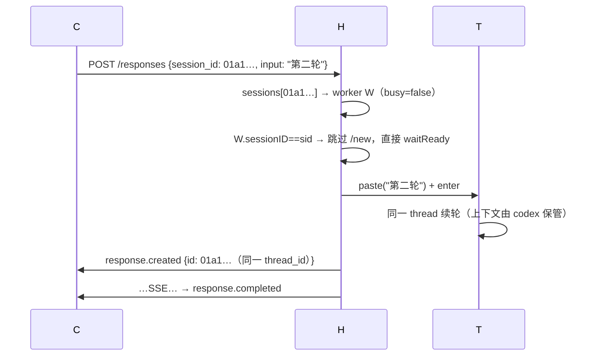

# 05 · 数据流全景（v0.1）

codex-tui-helper 方案的端到端数据流：入口 → 传输 → 首次进入 codex → 多轮 → 长对话 → 异常路径。

## 1. 总览

```
客户端 ──HTTP(S)──▶ vm2api 控制面 (Node)
                     │  codex-route.mjs：选槽、组装请求包
                     ▼ unix socket: vms/<id>/run/codex-kernel.sock
              codex-tui-helper (Go, 槽容器内)
                     │  PTY (200×50, TERM=xterm-256color)
                     ▼
              codex CLI 真实 TUI 进程
                     │  websocket(默认)/HTTPS fallback, reqwest+rustls
                     ▼ socks5h 固定代理 (REMOTE DNS)
              OpenAI backend (chatgpt.com / auth.openai.com)
                     │
                     ▼ 反向路径
      rollout-*.jsonl (CODEX_HOME/sessions/…) ──tail──▶ helper ──SSE──▶ 客户端
```

helper 自己**不发出任何上行请求**——上游流量 100% 来自真实 codex 二进制（TLS 指纹/clienthello = 官方 CLI）。

## 2. 各段数据形态

### 2.1 客户端 → 控制面

标准 OpenAI `POST /responses`（或其 API 的适配格式）。控制面按账号选槽后转发。

### 2.2 控制面 → helper（socket 请求）

```json
{
  "request_id": "req-abc",
  "stream": true,
  "body": {
    "model": "gpt-5.1-codex",
    "input": "用户 prompt 文本",
    "session_id": "可选：继续某会话",
    "previous_response_id": "可选：同上"
  }
}
```

传输：HTTP over unix socket `run/codex-kernel.sock`；认证头 `x-kin-internal-token`/`x-internal-token` 对照 `run/internal.token`。端点：`POST /internal/v1/codex/responses`、`GET /internal/health`、`POST /internal/v1/cancel`、`GET /internal/v1/codex/usage`。

### 2.3 helper → codex TUI（输入）

- **PTY** 启动：200×50，`--no-daemon`（保证杀进程=杀 turn）。
- prompt 通过 **bracketed paste** 注入（`\x1b[200~ … \x1b[201~`），不被 composer 解释成按键；以 `!`/`/`/`#` 开头的正文自动前置换行防误触发 shell/slash 模式。
- 注入完成判定：屏幕出现 `[Pasted … N chars]` chip 或输入尾部回显 → 发 `\r` 提交。

### 2.4 codex TUI → OpenAI（上行）

- 默认 websocket（`responses_websockets=2026-02-06` beta），HTTP POST fallback，reqwest+rustls 原生 ClientHello。
- 头部携带：`Authorization: Bearer`、`x-codex-installation-id`（`CODEX_HOME/installation_id`，codex 自生成 UUIDv4）、`originator`、session/thread/turn 元数据、`SessionSource::Cli`。
- 出口 = 配置 `proxy_url` → spawn env `HTTPS_PROXY/https_proxy/ALL_PROXY/all_proxy=socks5h://…`（socks5h 使 DNS 也在代理端解析）。
- token 刷新、模型列表、usage 查询全在二进制内部闭环，落盘只在 `CODEX_HOME` 内。

### 2.5 codex → helper（输出）

turn 产物 = rollout JSONL `CODEX_HOME/sessions/YYYY/MM/DD/rollout-<ts>-<thread_id>.jsonl`。行类型：

| type | 内容 |
|---|---|
| `session_meta` | thread id、cwd（按 cwd 关联 worker 目录找到本文件） |
| `turn_context` | 本轮环境上下文 |
| `response_item` | message/reasoning/tool 调用逐项 |
| `event_msg` | 终态：`task_complete`/`error`/`stream_error`/`turn_aborted` |
| `token_usage_record` | usage（嵌套 `payload.usage`） |

helper 按**字节偏移增量尾随**（append-only），翻译为上游 `response.*` SSE：`response.created` → `response.output_item.added/done` → `response.output_text.delta/done` → `response.completed` / `response.failed`。

## 3. 首次进入 codex（冷启动序列）



关键点：首次 spawn 做一次 `ensureHome`（auth/config/trust 就位）→ TUI 冷启动后如真人开着终端，**上下文从此活在 codex 自己的 thread 里，不做任何 replay**。

## 4. 多轮对话（会话亲和）

池模型：`worker{dir, tui, sessionID, rollout, off, model, busy, dead}` + `sessions[session_id]→worker`。

| 请求形态 | 处理 |
|---|---|
| 带 `session_id` 且会话在池中 | 路由到持有该 thread 的 worker，**直接在同一 codex thread 续轮**——上下文零重放，与真人继续敲字完全一致 |
| 带 `session_id` 但池中无 | 专用 worker `codex resume <sid>`（dir=resume-<sid>），从 rollout 恢复真实 thread 上下文 |
| 不带 `session_id` | 空闲 worker（model 匹配优先）；worker 已有会话 → 先发 `/new` 开新 thread 做会话隔离，再 paste |
| 池满 | 驱逐 idle worker（model 不匹配优先）；无 idle → `overloaded_error` |
| resume 失败 | 文本重放兜底（把历史 input/output 拼进 prompt） |

多轮流程（命中亲和）：



**同一会话上下文如何存**：codex 进程内存中的 thread + 磁盘 rollout JSONL。helper 不回放历史；续轮请求只要落到持有该 thread 的 worker，模型自带全部上文。进程被驱逐/死后，`codex resume` 从 JSONL 重建（与真实用户 `codex resume` 同源同形）。

## 5. 长对话 / 上下文溢出

- 上下文管理是 codex 内部职责（其 auto-compact/截断逻辑），helper 不干预——行为与真实 TUI 用户一致。
- rollout JSONL 随轮数线性增长；helper 只记字节偏移，尾随成本 O(新增字节)。
- 超长历史 + 进程丢失 → `codex resume` 恢复的是 codex 官方定义的 thread 状态（含 compact 后上下文），不失真。

## 6. 异常路径

| 场景 | 行为 |
|---|---|
| waitReady 超时 / 屏幕卡住 | `response.failed`（含末屏快照） |
| login/wizard 屏出现 | classifyScreen 分类上报，不 paste |
| turn 超时（默认 600s） | PTY 发 Esc 中断 turn，进程留池；SSE `response.failed` |
| TUI 进程死 | worker 标记 dead，release 时剔除；下个请求 lazy respawn |
| cancel 请求 | `request_id` → `Esc` 打断；不杀进程 |
| 凭证过期 | codex 自刷新 auth.json；刷新失败出现在 rollout error 事件 → `response.failed` |
