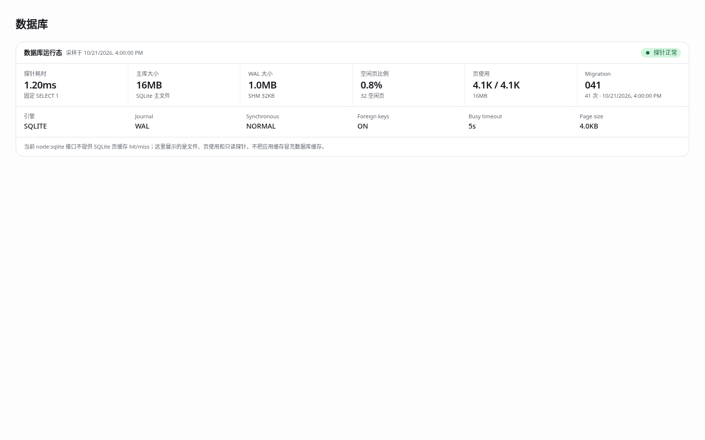
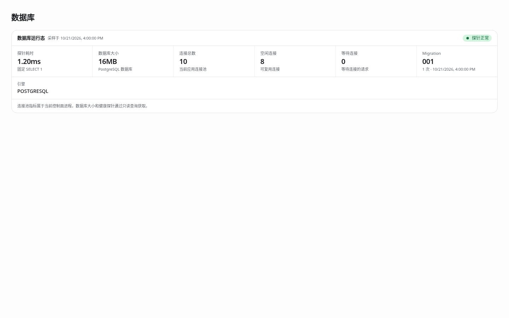

# SQLite 全面迁移到 PostgreSQL

日期：2026-10-21（北京时间）  
调研基线：`eee8f6ecb6ca04455e6edef0c8e498fb3be21f21`  
实施分支：`codex/postgresql-migration`  
状态：迁移实现已完成；全量回归与原始提交的失败对照见 [实施与验证报告](2026-10-21-postgresql-migration-results.md)。

## 1. 目标与边界

将控制面的运行数据库统一为 PostgreSQL，包括用户、API 密钥、分组、账号、调度状态、代理、集群节点、虚拟机元数据镜像、请求日志、计费、备份记录和思考签名归属。

应用运行、单元测试、端到端测试、运维查询和新备份都使用 PostgreSQL。SQLite 仅用于离线读取旧数据库、构造历史迁移测试数据及转换旧备份。运行时不保留双写或 SQLite 降级路径。

本分支完成代码、测试、迁移工具和部署说明。执行现有环境的数据迁移、停服、发布、修改现有服务配置和推送分支均不包含在本次本地实施范围内，需要相应操作的明确授权。

保留现有业务对象、权限边界、文件目录用途及对外 API 契约。`vms/*.json` 目前仍是 VM 运行操作的文件入口；本次不额外将整个 VM 文件模型改为数据库唯一存储。`VM2API_DB_SECRET` / `KIN_DB_SECRET` 仍是业务字段加密密钥，不能当作 PostgreSQL 登录密码，也不能在迁移时重新生成。

## 2. 已核实的现状

| 范围 | 现有实现 | 迁移影响 |
| --- | --- | --- |
| 数据库入口 | `src/lib/db/database.mjs` 使用 `node:sqlite.DatabaseSync`，默认 `<dataDir>/kin.db`，支持 `KIN_DB_PATH` | 打开、迁移、查询、事务和关闭均需异步化 |
| 数据访问 | `src/lib/db/repos/` 中 21 个模块，包含 20 个 repository/view 和 1 个共享 SQL 模块 | 调用者不能继续把查询结果当作同步值 |
| 版本迁移 | `src/lib/db/migrations/001_init.sql` 至 `041_usage_logs_inbound_device.sql`，逐文件事务和 SHA-256 校验 | PostgreSQL 建立独立迁移序列；原 SQLite 文件保持不变 |
| 最终表结构 | 在临时 SQLite 执行 41 个迁移后，有 29 张非 SQLite 内部表，包含 `schema_migrations` 和 3 张 `_legacy` 表 | 建立逐表清单，核对列、索引、默认值、外键及保留数据 |
| 额外表 | `src/lib/pool/thinking-owner.mjs` 在运行时创建 `thinking_signature_owners` | 纳入 PostgreSQL 正式迁移与存量导入 |
| VM 元数据镜像 | `src/lib/vm/vm-db-sync.mjs` 通过写钩子、启动校对及文件监听镜像到数据库；`VmsRepo` 移除活凭据，只保留元数据和凭据存在标记 | 异步写入必须可等待、可排空，删除顺序不能改变 |
| 备份 | `src/lib/admin/backup-core.mjs` 使用 `VACUUM INTO`，归档含 `db/kin.db`、VM 和配置文件 | 更换数据库快照格式，保留原归档的其他内容 |
| 恢复 | `backup-service.mjs` 关闭 SQLite、替换文件、重新绑定 store | PostgreSQL 恢复需维护模式、排空写入及恢复后重新加载 |
| 恢复入口隔离 | `src/server.mjs` 的恢复标志目前主要拦截推理入口 | 需要同时控制面板和后台数据库写入 |
| 监控与界面 | `database-metrics.mjs` 和数据库页面展示 SQLite/WAL/PRAGMA/页信息 | 改为 PostgreSQL 数据库、连接池和迁移指标 |
| 部署 | 控制面 Compose 使用 `network_mode: host`；存在 amd64、arm64 两种镜像构建 | PostgreSQL 地址、网络暴露、客户端版本及两种构建都需覆盖 |
| 测试 | 临时目录隔离 SQLite，`test/harness.mjs` 派生网关进程 | 改用独立 PostgreSQL 测试数据库，并隔离每个测试实例 |

当前 SQLite 表清单：

```text
account_allocations, account_groups, account_runtime,
account_runtime_states_legacy, accounts, accounts_legacy,
api_endpoint_keys, api_endpoint_models, api_endpoints, api_keys,
backup_records, cluster_node_direct_links, cluster_nodes, groups,
panel_users_legacy, proxies, redeem_codes, refusal_device_blocks,
refusal_guards, request_attempts, request_log_debug, schema_migrations,
settings, sticky_sessions, usage_logs, users, vm_pool_members, vm_pools, vms
```

`thinking_signature_owners` 为以上清单之外的运行时表。数据导入不能仅按 migrations 中的建表语句搜索结果决定范围。

## 3. 实现方案

### 3.1 驱动、生命周期与事务

- 使用 `pg`（node-postgres）连接池和原生异步查询。SQL 参数使用 `$1`、`$2` 等占位符；仓库不增加运行时 SQLite SQL 翻译器或同步线程代理。
- 连接配置沿用现有 `VM2API_*` 优先、`KIN_*` 作为 fallback 的规则：`VM2API_DATABASE_URL` 优先于 `KIN_DATABASE_URL`，仅接受 PostgreSQL 连接字符串。未配置或连接失败时，在监听 HTTP 端口之前失败。`KIN_DB_PATH` 仅保留在离线源文件工具中，应用不得悄悄回退到 SQLite。
- `await openDatabase()` 完成连接探针、迁移和必要初始化，再创建或初始化 store。构造函数不执行未等待的异步数据库写入；需要初始化时使用显式 `init()` 或工厂，并在启动阶段等待。
- `await closeDatabase()` 排空连接池。关闭、恢复和测试清理必须等待正在执行的操作结束。
- `withTransaction` 等待回调完成后提交。一个事务中的查询固定使用同一个连接，嵌套调用沿用同一事务。实现时选择显式传递事务对象；调用层级确有必要时再使用 `AsyncLocalStorage`，不同时维护两套事务机制。
- 迁移使用数据库级 advisory lock 串行化并发启动。迁移锁、SQL 与迁移记录必须在同一个专用连接执行；连接在成功和异常路径都释放。
- SQL 错误不得打印连接字符串、密码、参数值或凭据列。事务中不得沿用 SQLite 的“捕获单行错误后继续执行”方式；可预先校验的数据先校验，必须局部容错的操作使用 savepoint。

### 3.2 表结构和数据契约

- PostgreSQL 基线按当前 SQLite 的最终结构建立，不在 PostgreSQL 上重放 41 个旧迁移。新旧 `schema_migrations` 分别记录各自引擎的版本，不把 SQLite 校验和当作 PostgreSQL 校验和。
- 基线包含 `thinking_signature_owners`。3 张 `_legacy` 表中的历史记录也纳入显式保留清单，不静默丢弃。旧 SQLite 的迁移记录写入导入清单作为源版本证据。
- JSON 和 ISO 时间先保留为 `text`；整数布尔值保持 `0/1`。本次不混入 `jsonb`、时间输出格式或业务字段加密格式的改变。
- 原 SQLite `REAL` 按其双精度语义映射到 `double precision`。不在同一次迁移中改变计费舍入规则。余额和费用使用固定测试数据比较迁移前后结果。
- SQLite `INTEGER` 是 64 位。毫秒时间戳、token 计数、累计次数、字节数等不能机械改为 PostgreSQL 32 位 `integer`；逐列选择 `bigint` 或有界 `integer`。统一处理 `pg` 返回的 bigint/count/sum，超出 JavaScript 安全整数时不得静默截断。
- 自增列使用 identity/sequence，并用 `INSERT ... RETURNING id` 取值。固定分组种子和导入的显式 ID 完成后更新 sequence。
- 保留现有外键和级联语义。本次不额外为旧数据增加未评估的业务约束。
- 用户名和 VM 池名称保持现有 SQLite `NOCASE` 行为。其默认大小写折叠主要针对 ASCII，不能直接用 Unicode `lower()` 宣称等价。实现可用固定 ASCII 大小写映射表达式及一致的唯一索引；登录查询与索引必须采用同一规则，并测试非 ASCII 名称。
- PostgreSQL 新空库包含默认分组；存量导入时应在同一事务中移除基线种子并导入源分组，不能因为种子存在而绕过“目标为空”的检查。

### 3.3 SQL 与异步调用链

| SQLite 用法 | PostgreSQL 实现要求 |
| --- | --- |
| `?` | 调用处显式使用 `$n`，保持参数化 |
| `IFNULL` | 改为 `COALESCE`，核对聚合返回类型 |
| `LIKE` | 日志搜索保留默认 ASCII 大小写不敏感和反斜杠字面量语义；两侧使用一致 ASCII fold 并显式 `ESCAPE ''`，对照验证 `%` / `_` 通配行为，不直接将 `ILIKE` 当作等价替代 |
| `INSERT OR IGNORE` | 改为带实际冲突目标的 `ON CONFLICT DO NOTHING`，不吞掉其他约束错误 |
| `lastInsertRowid` | `RETURNING id` |
| `strftime` / `printf` | PostgreSQL 时间或字符串表达式；保持 UTC、上海自然日和 IANA 时区/夏令时行为 |
| `json_each` | 原生数组参数及 `ANY`，或显式 JSON 数组展开 |
| `rowid` 分页 | 稳定业务主键的 keyset pagination，不使用 `ctid` |
| 宽松 `GROUP BY` | 选择列与分组表达式一致；重点修正 statistics leaderboard |
| 浮点 `CAST(... AS INTEGER)` | 明确截断或舍入，不能依赖两种引擎的隐含差异 |
| PRAGMA / `sqlite_master` | 正式迁移、PostgreSQL catalog 或 information_schema |

新增 `await` 后还要检查下列语义：

1. `ApiKeyStore` 的鉴权、额度和并发准入：数据库读取完成后，最后的内存限流检查与 inflight 占位连续执行；失败路径释放占位。
2. 账号状态、额度、余额等读改写：改为原子 UPDATE 或行锁事务，避免两个 await 路径相互覆盖。兑换码保持一次使用与余额更新的原子性。
3. 同步配置回调：在异步边界预取，或复用已有配置的内存状态并在启动/修改/恢复时等待更新，不能把 Promise 当配置对象。
4. 定时任务、事件监听、数组遍历和流式响应结束回调：明确等待或排队，禁止 `forEach(async ...)` 等未跟踪写入。
5. VM 写钩子：保留现有文件入口，提供有顺序的数据库镜像写入与 flush；读取镜像、备份、删除、恢复和关闭前等待相关写入。失败不能报告镜像成功；删除后不能被迟到 upsert 或启动恢复重新创建。

### 3.4 存量迁移

提供显式离线命令，暂定 `npm run db:import:sqlite -- --source <snapshot.db>`。目标连接只从环境读取，命令行不携带密码。应用启动时不自动发现或导入旧文件。

1. 切换操作前冻结原应用所有写入，排空在途请求和后台任务。以 SQLite 一致性快照和文件归档作为输入，不直接复制正在写入的 `.db` 主文件而遗漏 WAL。
2. 原 SQLite 文件只读保留。历史版本升级仅在工具创建的临时副本执行，复用原校验和及历史 001 schema 修复逻辑；不就地修改原库。
3. 识别旧版本和未知表/列。未知版本、校验和错误或存在未映射业务数据时拒绝导入，给出不含业务行的诊断。额外历史表和运行时表按清单迁移。
4. 校验目标为新基线且没有业务数据。导入使用一个事务并互斥执行，按依赖顺序导入；对集群节点自引用关系采用父节点优先顺序或可延迟约束，不能靠关闭约束忽略问题。
5. 保留主键、NULL、租户归属、密文、JSON 字符串、时间文本和业务值。SQLite 源查询启用 `statement.setReadBigInts(true)`，超出 JavaScript 安全整数的值用无损十进制字符串绑定 PG、计算摘要和序列化，不能先转成 `Number`。保持原业务加密密钥，禁止将凭据解密后输出或重写。
6. 更新 sequence 时取源 `sqlite_sequence.seq` 和最大现存 ID 的较大值，保留已经删除记录的自增高水位。采用可回滚的 sequence restart；若使用不可回滚的 `setval`，必须保存并恢复失败前序列状态并测试。逐表比较行数、主键集合和按稳定主键顺序计算的规范化内容摘要；另核对余额、费用、token 合计及外键关系。浮点聚合约定容差，逐行 double precision 应保留相同数值。
7. 校验通过后，将源版本、源文件摘要、逐表验证结果和完成标记与数据一并提交。失败整体回滚；不能留下“已导入”标记或半成品。再次执行对已导入目标明确拒绝。
8. 保留输入快照、文件归档和不含敏感值的结果清单。目标开始接受新写入前可以回到原 SQLite；目标接受写入后，原库已过时，不能直接切回并声称无数据丢失。

### 3.5 备份、恢复与运维

- 新备份格式使用 `pg_dump` custom archive，并继续归档 VM JSON、现有配置和清单。清单写明备份格式、数据库引擎、schema 版本和文件摘要，不包含连接凭据。
- 数据库快照与 VM/配置文件必须有明确的一致性边界。暂停应用的数据库与相关文件写入、排空 VM 镜像队列，在专用事务中用 `pg_export_snapshot()` 建立快照，并在该冻结窗口复制文件。随后恢复写入，用 `pg_dump --snapshot` 导出；导出事务保持到 dump 完成为止。子进程已启动不代表快照已建立。不能把独立时刻的数据库 dump 与凭据文件称为一致快照。
- 备份在异步子进程/现有 worker 执行，保证 HTTP 事件循环可响应。PostgreSQL 客户端主版本与支持的服务端版本对齐；两种 Debian Bookworm 镜像通过官方 PGDG 来源安装 `postgresql-client-17`，验证 amd64、arm64 的 `pg_dump` / `pg_restore` 主版本。不能只安装发行版默认客户端而得到 PG 15。
- 新版恢复显式进入维护模式：拒绝新增推理和面板写入，暂停后台写任务，排空请求、事务及 VM 镜像队列，再制作恢复前备份。维护操作使用受控内部入口，避免被自身写入门禁止。
- 恢复实现先在隔离测试数据库验证。实际恢复前检查归档校验和与 `pg_restore --list` 的对象清单，只允许应用所属 schema 和约定对象；目标恢复使用单事务的受限操作，不能通过删除整个数据库扩大权限。数据库恢复与文件替换不是跨资源原子事务，文件提前校验并准备临时目录；切换失败时使用恢复前快照回退，未恢复一致前保持维护状态。
- 生产应用使用专属数据库和固定应用 schema（默认 `public`）。数据库查询、备份 worker 和恢复子进程均传播同一目标及 schema；`pg_dump` 显式限定应用 schema，`search_path` 不代替备份范围限制。旧归档 schema 与目标不匹配时拒绝直接恢复，通过明确转换入口处理，不用字符串替换改写 dump。
- 恢复成功必须等待 store、分组、API 调度、路由、监控、账号运行状态和 VM 镜像重新绑定/加载，随后才退出维护模式。恢复失败不能沿用无条件 `finally` 清除维护标志的行为。
- 保留 `_registerOrphanArchives` 的归档重新登记行为。恢复后仍可列出恢复前备份和被恢复的归档，并能从面板发起撤销恢复；数据库记录恢复不等于归档文件自动恢复。
- 旧 `.tar.gz` 的 `db/kin.db` 及旧 `.db.gz` 提供显式转换入口，复用离线导入和校验逻辑。旧记录中的文件路径不会因为迁移到 PG 自动恢复文件；保留原备份目录并测试记录与文件关系。
- 数据库 API 和页面改用健康探针、数据库大小、连接池 total/idle/waiting、迁移状态。字段不暴露数据库地址、用户名、密码或连接字符串。
- Compose 提供持久化 PostgreSQL 服务及健康检查。控制面保留 host 网络时，PG 仅绑定宿主 `127.0.0.1` 的可配置端口，连接 URL 与此一致；支持外部 PostgreSQL，不能硬编码容器服务名为 host 网络下的地址。
- 更新 `.env.example`、安装脚本、容器入口、systemd 示例、部署说明和 ARM64 测试，处理旧安装升级后缺少数据库连接的情况。`scripts/panel-upgrade.sh` 必须在替换旧容器之前预检 PG 连接、迁移完成标记及所需 Compose 服务；其现有 `--no-deps` 升级不会自动创建 PG 服务，镜像分支也不会刷新 Compose，必须显式覆盖。未迁移的 SQLite 安装在替换容器之前拒绝升级。启动也应拒绝将存在旧 SQLite 数据却没有导入标记的安装作为新空 PG 安装提供服务。
- `deploy/init-arm64-env.py`、`test/deploy/smoke_arm64_image.py` 和调用它的 test/release workflow 一并更新。现有 ARM64 smoke 使用 `--network none`，迁移后改为专用测试网络和临时 PG 17，并清理数据库、网络和容器；不连接现有服务或扩大 Docker socket 权限。

## 4. 实施任务与提交顺序

| 任务 | 依赖 | 文件范围 | 交付与验收 |
| --- | --- | --- | --- |
| T0 结构和行为基线 | 无 | 本计划、`test/fixtures/`、必要的只读测试辅助工具 | 29 表及动态表清单、索引/约束/type 映射、当前/历史 SQLite fixture、计费与时区对照结果；fixtures 只含合成数据 |
| T1 PostgreSQL 基础 | T0 | `package.json`、lock、`src/lib/db/database.mjs`、PG 新迁移目录、数据库测试辅助工具 | 异步连接池、初始化/关闭、校验和、迁移锁、单连接事务；先在隔离 PG 测试中覆盖错误路径 |
| T2 基础 repository | T1 | `src/lib/db/repos/` 中非日志统计模块及对应测试 | 用户/分组/密钥/账号/代理/端点/集群/VM/账号池/拒绝记录/兑换码异步 SQL；唯一性、外键和并发测试通过 |
| T3 日志、统计和计费 | T1 | `usage-logs-repo.mjs`、`usage-logs-view.mjs`、`statistics-repo.mjs`、`usage-log-preds.mjs`、`admin/request-log.mjs`、`admin/error-class.mjs` 及测试 | 原生 PG SQL、稳定重定价分页、时区分桶、权限筛选、费用/余额及 retention 结果与基线一致 |
| T4 store 和业务调用链 | T2、T3 | `src/server.mjs`、`src/lib/admin/` 的相关 store/路由、`src/lib/pool/`、`src/lib/protocol/`、`src/lib/vm/` 相关调用者 | 启动到关闭全链路 await；内存并发准入、配置、思考签名、流式结束日志和 VM 镜像语义验证 |
| T5 旧数据与备份转换工具 | T0、T1、T2、T3 | `src/lib/db/legacy-import.mjs`、SQLite 专用离线模块、`scripts/` 迁移命令、迁移测试 | 源只读、历史临时升级、空目标检查、事务导入、校验、sequence、重复执行和失败回滚；包含 JSON 旧数据导入 |
| T6 备份与恢复 | T4、T5 | `backup-core.mjs`、`backup-worker.mjs`、`backup-service.mjs`、server 恢复回调和测试 | PG 备份、全写入口维护隔离、数据库和文件一致性、异步重新绑定、旧归档转换及失败回退 |
| T7 运维与界面 | T1、T4、T6 | `database-metrics.mjs`、数据库 API/类型/页面、4 个 audit 脚本、Compose、两种 Dockerfile、安装/入口/升级脚本、`deploy/init-arm64-env.py`、`test/deploy/smoke_arm64_image.py`、`test/unit/panel-upgrade-script.test.mjs`、部署文档 | PG 指标、无敏感信息的配置、amd64/arm64 构建、旧安装升级前检查；数据库页面同窗口宽度截图对照 |
| T8 全量回归与迁移演练 | T2–T7 | `test/harness.mjs`、相关单元/E2E、`.github/workflows/test.yml`、`.github/workflows/release.yml`、本计划验证记录 | CI 使用真实隔离 PG，当前/历史源导入、新请求持久化、重启、备份恢复及失败演练全部记录实际结论 |

T2/T3 可按文件范围并行。T5 在数据库契约稳定后并行。T4 与 T6 都会修改 server，必须由同一集成负责人顺序合入。数据库基础与所有调用者异步化完成前，分支不作为可部署版本。

每个任务独立提交。若实施中复现现有缺陷，低成本回归测试先单独提交，再提交修复。每次验证记录实际 commit SHA；后续代码改动后重新执行受影响的检查。

## 5. 验证方案与完成条件

### 5.1 隔离环境

选 PostgreSQL 17 作为首次实现和 CI 的固定主版本，匹配相同主版本客户端。使用专用本地测试数据库和合成数据，不读取现有部署的凭据或业务数据。测试配置独立于生产配置，名字与连接目标都必须通过 `_test` / 专用测试库保护检查。

所有测试只连接预建的专用 `_test` 数据库。每个测试和派生网关使用独立 schema；测试辅助工具向所有连接和子进程传播固定 search_path，并在结束后关闭连接再删除本测试的 schema。备份恢复显式限定应用 schema，应用 schema 与归档保持一致，`pg_restore` 不承担跨 schema 重命名。通过相邻 schema 的 sentinel 恢复测试验证范围。测试辅助工具不创建或删除数据库，不需要建库权限。集成测试缺少 PG 时明确失败，不静默改用 SQLite。

### 5.2 必须通过的场景

| 范围 | 场景 |
| --- | --- |
| 初始化 | 空库、重复启动、两个进程并发迁移、校验和不匹配、失败 SQL 回滚、连接不可用、关闭释放连接 |
| 数据导入 | 当前 41 版与有覆盖的历史源、历史 001 proxy schema、旧 JSON 导入、3 张 legacy 表和动态表、NULL/密文/大整数、未知结构拒绝、失败回滚、非空目标拒绝、sequence 后续插入 |
| 用户和权限 | 登录、大小写唯一性/非 ASCII、停用与软删除、租户隔离、API 密钥权限和额度、VM 池成员隔离 |
| 并发 | 同时兑换同一码仅一次成功；余额和用量更新不丢失；同一 key 的并发准入不超限；事务失败无部分更新；VM 写入与删除不乱序 |
| 正常请求 | 通过现有 mock 上游的正常 HTTP 推理入口产生请求、日志和账单；包含流式/非流式、失败、重试、思考签名归属；重启后再查询持久化结果 |
| 统计 | UTC、Asia/Shanghai、含夏令时的 IANA 时区，零值/NULL，租户筛选，leaderboard，分页和全量重定价无遗漏重复，费用与 token 合计 |
| VM | 凭据文件变更镜像、外部文件变更、启动恢复、删除与在途写入、镜像失败、备份/恢复前 flush |
| 备份恢复 | 手动/定时备份、校验与下载、保留策略、恢复前备份、旧归档转换、损坏文件拒绝、恢复中所有写入口受控、恢复失败维护状态、恢复后业务请求 |
| 监控和部署 | PG 指标类型、连接信息脱敏、测试隔离清理、amd64/arm64 镜像和启动、Compose 内置 PG 与外部 PG 配置 |

重点保留并迁移的现有测试包括：

```text
test/unit/database.test.mjs
test/unit/db-migration-sub2api.test.mjs
test/unit/legacy-import.test.mjs
test/unit/database-metrics.test.mjs
test/unit/backup-service.test.mjs
test/unit/statistics-repo.test.mjs
test/unit/usage-logs-repo.test.mjs
test/unit/tenant-billing.test.mjs
test/e2e/persistence.e2e.test.mjs
test/e2e/backup.e2e.test.mjs
test/e2e/panel-users.e2e.test.mjs
```

### 5.3 验收门槛

1. `npm run test:unit` 与 `npm run test:e2e` 在隔离 PostgreSQL 上通过；记录通过/失败/跳过的实际数目和原因。只在离线源 fixture 中保留 SQLite 测试。
2. `npm run test:go`、api-kernel 现有 Go 测试、前端测试/构建和相关格式、语法检查通过。运行所需的现有预编译 payload 需按仓库脚本准备；缺失时记录未验证，不把依赖缺失误报为数据库通过。
3. 数据库页面与现有页面各提供一张相同窗口宽度的截图；保留现有组件和布局，只调整引擎相关信息。
4. 当前/历史 SQLite 迁移演练、迁移回滚、PG 备份恢复演练以及正常 HTTP 请求持久化均通过，不能以连接成功代替业务验证。
5. 检索 `node:sqlite`、`KIN_DB_PATH`、`VACUUM INTO`、`sqlite_master`、`PRAGMA`、`rowid`、SQLite 方言及旧同步调用。每个剩余命中都解释为离线兼容、历史迁移或历史文档；运行路径不得依赖它们。
6. 报告标明被验证 SHA。若获准部署，用新行为和运行镜像 digest 验证实际版本；版本号或进程上报 SHA 不作为唯一依据。

## 6. 调研验证记录

2026-10-21，对源码基线 `eee8f6ecb6ca04455e6edef0c8e498fb3be21f21` 执行：

```sh
node --test test/unit/database.test.mjs test/unit/db-migration-sub2api.test.mjs test/unit/database-metrics.test.mjs
```

结果：3 个测试文件通过，0 个失败，0 个跳过。此结果只证明现有 SQLite 基线的上述测试文件通过，不构成 PostgreSQL 验证。

使用临时目录执行全部现有迁移并只读查询 schema：41 个迁移，29 张非 SQLite 内部表。临时目录已删除；未读取现有业务数据库。

本机 Node.js 为 `v24.19.0`。调研阶段 `psql`、`postgres`、`initdb` 不在 PATH；Docker 首次查询返回 `permission denied while trying to connect to the docker API at unix:///var/run/docker.sock`。实施阶段已通过工具权限审核创建本任务专用 PostgreSQL 17 容器，并取得匹配的客户端。该容器只含合成数据，不使用现有部署的连接或业务数据。

参考官方资料：

- [node-postgres：事务必须使用同一 client](https://node-postgres.com/features/transactions)
- [node-postgres：连接池](https://node-postgres.com/apis/pool)
- [PostgreSQL 17：pg_dump](https://www.postgresql.org/docs/17/app-pgdump.html)
- [PostgreSQL 17：pg_restore](https://www.postgresql.org/docs/17/app-pgrestore.html)
- [PostgreSQL：Debian PGDG 客户端安装](https://www.postgresql.org/download/linux/debian/)

计划已由两个只读审查任务分别核对数据层和运维/测试范围。已补充 schema 备份隔离、升级前检查、导出快照同步、客户端主版本、LIKE 语义、大整数源读取和自增高水位要求。该审查仅验证计划覆盖与源码事实，不代表迁移实现已经通过验证。

## 7. 实施记录

- `fa0decc2`：PostgreSQL 驱动、独立基线和离线 SQLite 模块。
- `3225b073`：基础 repository 与异步 store。
- `893cb3ce`：日志、统计和计费查询。
- `720a0474`：只读 SQLite 快照导入、事务校验和旧备份转换。
- `1a5a7520`：导出快照备份、受控恢复和失败后维护状态。
- `c2e56a2d`：PostgreSQL 部署、升级预检、指标与页面。
- `38f6db6e`：启动、请求、调度、VM 镜像、恢复与关闭的异步调用链。
- `3fbdc4bc`：独立 PG 测试 schema、CI 和重启持久化验证。
- `6cb132b6`、`71ea797b`：整数精度及合法小数权重、端点优先级修正。
- `4ad444d7`：关闭时等待已进入的备份调度检查。
- `6aa877de`：区分恢复与普通维护提示，隔离慢代理测试的自动备份时序干扰。

具体实施时采用 `AsyncLocalStorage` 保持事务连接，savepoint 回滚同步丢弃未提交的缓存更新。保留 SQLite 字符串排序和 ASCII 大小写语义。SQLite 中声明为 INTEGER 的 `accounts.load_factor` 实际接受小数，PG 对应列使用 double precision，已用 1.25 权重导入回归验证。累计整数超出安全范围时以精确十进制字符串返回；余额、费用、平均值和比率保留原 double precision 语义。

VM 活凭据继续保留在既有槽位和 CLI-home 存储中。数据库导入和顶层 JSON 归档不能重建这些凭据。迁移操作必须原样保留对应目录及原业务加密密钥。

页面对照使用合成指标、相同组件依赖与样式、1440×900 窗口。用户已授权独立 Playwright 截图：

| 原 SQLite 页面 | PostgreSQL 页面 |
| --- | --- |
|  |  |

验证对象、实际结果和未验证项记录在同目录实施报告中。未对现有部署执行迁移、重启或发布，未推送分支。
